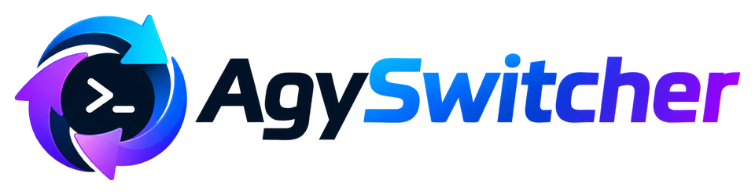

<h1>
  <picture>
    <source media="(prefers-color-scheme: dark)" srcset="docs/assets/logo/agyswitcher-logo-dark.png">
    
  </picture>
</h1>

*Switch accounts. Keep coding.*

**AgySwitcher** es una herramienta para Windows que te ayuda a trabajar con **varias cuentas
de Google en Antigravity CLI (`agy`)** y a **seguir con el mismo proyecto** cuando una cuenta
agota su cuota.

- Muestra la cuota y la fecha de reinicio de cada cuenta, y cuál es la siguiente disponible.
- Avisa cuando la cuota baja del 15 % (configurable) y te deja en el portapapeles la
  instrucción para que el agente guarde el estado a tiempo.
- Te guía al cambiar de cuenta y **comprueba** que has iniciado sesión con la correcta.
- Prepara tus proyectos (`AGENTS.md`, `dev_mem/`) para que la siguiente sesión, con otra
  cuenta o con otro agente de IA (Gemini, Claude, ChatGPT/Codex, Copilot, Cursor), sepa
  dónde lo dejaste.
- **Seguridad primero:** no lee, copia ni guarda contraseñas ni tokens, nunca inicia sesión
  por ti y no envía nada fuera de tu equipo.

**¿Para quién?** Estudiantes, personas que empiezan a programar y programadores
independientes que quieren usar un agente de IA sin pagar una suscripción, o probarlo antes de
decidirse. La cuota gratuita de Antigravity es limitada; con varias cuentas propias puedes
seguir trabajando sin perder el contexto. Y como el contexto vive en el proyecto, puedes
**combinar `agy` con otros agentes y proveedores** (Claude Code, Codex…) sobre el mismo
código. Guías: [Uso en el día a día](docs/manual/dia-a-dia.md) ·
[Varios agentes y proveedores](docs/manual/multiagente.md).

## Cómo funciona

`agy` guarda una única sesión de Google en el Administrador de credenciales de Windows, y su
carpeta `%USERPROFILE%\.gemini` (historial, conversaciones, MCP, *skills*) es común a todas
las cuentas. Cambiar de cuenta consiste en cerrar sesión en `agy` (`/logout`) e iniciarla con
otra: AgySwitcher te dice con cuál, lo verifica y te da la instrucción para que el agente
retome el proyecto desde su memoria en `dev_mem/`.

Más detalle en [Conceptos](docs/manual/conceptos.md).

## Instalación

**Requisitos:** Windows 10/11 y Antigravity CLI (`agy`) funcionando.

- **Instalador para Windows** (sin Python ni administrador): descárgalo de
  [Releases](https://github.com/gabimarti/agyswitcher/releases).
- **Desde el código fuente** (Python 3.11+ y Git):

  ```powershell
  git clone https://github.com/gabimarti/agyswitcher.git
  cd agyswitcher
  .\scripts\setup.ps1
  .\.venv\Scripts\Activate.ps1
  ```

Detalles, actualización y desarrollo: [Instalación](docs/manual/instalacion.md).

## Uso rápido

```powershell
agyswitcher add personal --email personal@example.com   # registra tus cuentas
agyswitcher add trabajo  --email trabajo@example.com --no-activate
agyswitcher list                                         # cuota de cada cuenta

cd C:\ruta\a\mi-proyecto
agyswitcher init                 # prepara el proyecto (AGENTS.md, dev_mem/...)

agyswitcher handoff save         # cuando la cuota baja: el agente guarda el estado
agyswitcher set-active trabajo   # cambio de cuenta guiado y verificado
```

## Documentación

Web con el manual completo: **[gabimarti.github.io/agyswitcher](https://gabimarti.github.io/agyswitcher/)**

- [Manual de usuario](docs/manual/index.md)
  - [Instalación](docs/manual/instalacion.md) · [Uso en el día a día](docs/manual/dia-a-dia.md) ·
    [Conceptos](docs/manual/conceptos.md) · [Varios agentes](docs/manual/multiagente.md) ·
    [Comandos](docs/manual/comandos.md) · [Continuidad del proyecto](docs/manual/continuidad.md) ·
    [Problemas frecuentes](docs/manual/problemas.md) · [Desinstalación](docs/manual/desinstalacion.md)
- Tutoriales: [proyecto nuevo](docs/tutoriales/proyecto-nuevo.md) ·
  [proyecto existente](docs/tutoriales/proyecto-existente.md)
- Para desarrolladores: [arquitectura técnica](docs/architecture.md) ·
  [hoja de ruta](docs/roadmap.md) · [cómo contribuir](CONTRIBUTING.md) ·
  [seguridad](SECURITY.md)

## Versiones

Consulta tu versión con `agyswitcher --version` y los cambios de cada versión en
[CHANGELOG.md](CHANGELOG.md).

## Apoya el proyecto

AgySwitcher es y seguirá siendo gratuito y de código abierto. Si te resulta útil y quieres
apoyarlo, puedes invitarme a un café en Ko-fi. Es totalmente voluntario y no da acceso a nada
extra: solo ayuda a dedicarle más horas.

[](https://ko-fi.com/gabimarti)

## Autoría y contacto

- **Autor:** Gabriel Marti
- **Sitio web:** [https://gabimarti.github.io/](https://gabimarti.github.io/)
- **Email:** [contact@gabimarti.slmail.me](mailto:contact@gabimarti.slmail.me)

## Licencia

Copyright (C) 2026 Gabriel Marti

AgySwitcher es software libre: puedes redistribuirlo y/o modificarlo bajo los términos de la
**Licencia Pública General de GNU (GPL)** publicada por la Free Software Foundation, ya sea la
versión 3 de la licencia o (a tu elección) cualquier versión posterior
(`GPL-3.0-or-later`).

Se distribuye con la esperanza de que sea útil, pero **SIN NINGUNA GARANTÍA**; ni siquiera la
garantía implícita de COMERCIABILIDAD o IDONEIDAD PARA UN PROPÓSITO PARTICULAR. Consulta el
texto completo de la licencia en el fichero [LICENSE](LICENSE).
