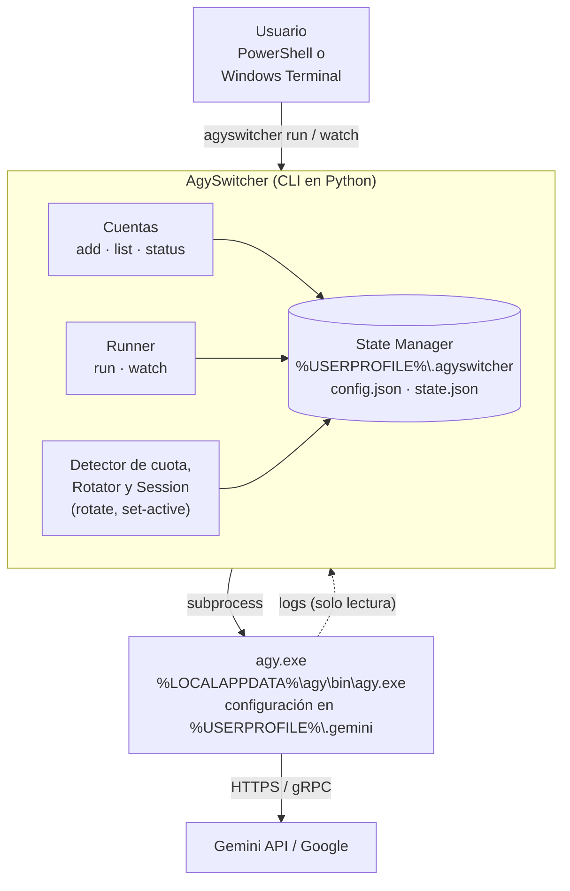
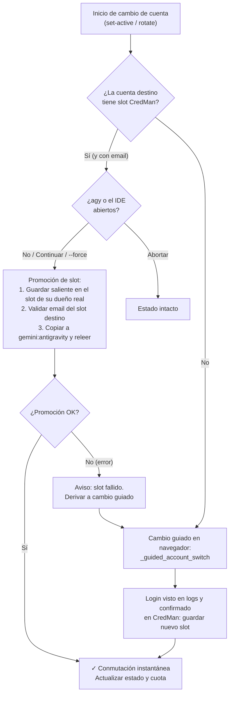
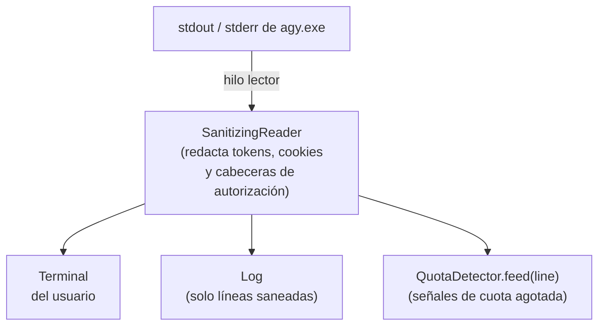
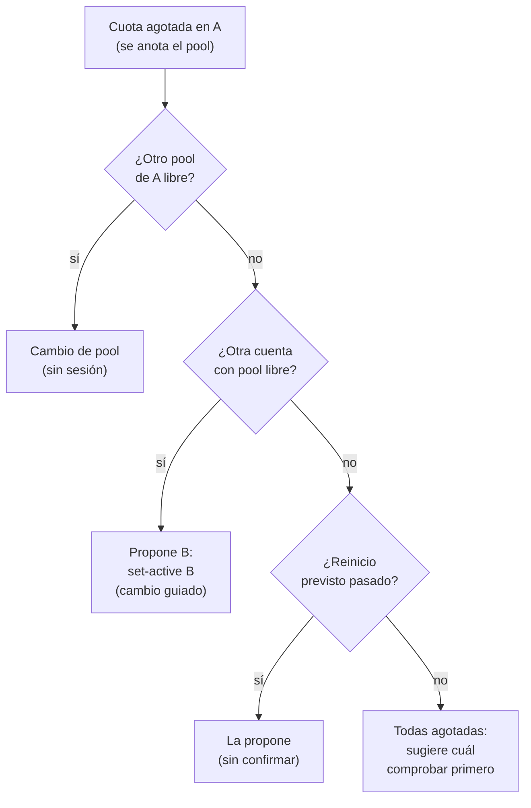

# Arquitectura Técnica — AgySwitcher

**Versión:** 1.5.0 (Conmutación por slots en Windows Credential Manager)  
**Fecha:** 2026-11-23  
**Estado:** Implementado (Fases A0-A6).

---

## 1. Propósito y Principios de Diseño

**AgySwitcher** es un orquestador externo, seguro y nativo para Windows que envuelve
Antigravity CLI (`agy`) para gestionar múltiples cuentas de Google y reaccionar ante
el agotamiento de cuota (rate limit) de forma transparente para el usuario.

### Principios rectores

| Principio | Descripción |
| :--- | :--- |
| **No invasivo** | No modifica los archivos internos de `agy`, ni accede, descifra ni exporta tokens OAuth. |
| **Windows nativo** | Usa `pathlib.Path`, rutas absolutas a los ejecutables y APIs de consola de Windows en lugar de construcciones POSIX. |
| **Seguro por diseño** | Cualquier dato proveniente de procesos hijos (`agy`) se trata como no confiable. Los patrones sensibles se redactan antes de cualquier log. |
| **Transparente** | El usuario siempre sabe qué cuenta está activa. Las rotaciones automáticas se notifican explícitamente; las manuales requieren confirmación. |
| **Sin privilegios especiales** | No requiere ejecución como Administrador ni modo Developer de Windows para sus operaciones núcleo. |

---

## 2. Visión General del Sistema



---

## 3. Cuentas, sesión de `agy` y cambio de cuenta

### 3.1 Hallazgos empíricos

1. **`agy.exe`** lee su configuración, historial, conversaciones, MCP y *skills* de
   `%USERPROFILE%\.gemini\` (subcarpetas `antigravity-cli`, `antigravity`, `config`,
   `skills`...). El IDE de Antigravity comparte esa carpeta.
2. **La sesión de Google reside en Windows Credential Manager** (verificado el 2026-11-18 y
   2026-11-23). `agy` almacena su sesión activa en una credencial genérica de nombre fijo
   `gemini:antigravity`.
   Para alternar cuentas sin depender del navegador en cada rotación, AgySwitcher gestiona
   *slots* de sesión en el almacén seguro nativo de Windows (DPAPI) bajo el espacio de nombres
   `gemini:antigravity:slot:<alias>` (`credman.py`). Ningún token ni secreto se escribe jamás
   en archivos locales ni registros de AgySwitcher.
3. Al completar un inicio de sesión (y también al arrancar con la sesión guardada), `agy`
   escribe en sus logs `OAuth: authenticated successfully as <email>`. Es la señal usada
   para verificar un cambio de cuenta (§3.3).
4. La detección de cuota se realiza leyendo `%USERPROFILE%\.gemini\antigravity-cli\cli.log`
   y los logs rotados de `antigravity-cli\log\`, además de la salida de `agy` en `run`.

### 3.2 Decisión de diseño: carpeta `.gemini` única y compartida

`%USERPROFILE%\.gemini` es **común a todas las cuentas** y AgySwitcher **no la modifica**.
Así, al cambiar de cuenta cuando la actual agota su cuota, se conservan historial,
conversaciones, servidores MCP y *skills*, y se puede continuar el mismo proyecto.

### 3.3 Ciclo de vida de un cambio de cuenta (conmutación por slots y fallback guiado)

`rotate <alias>` / `set-active <alias>` cuando cambia la cuenta (`_switch_account` en `cli.py`):



1. **Vía A — Conmutación instantánea por slot (`credman.promote_slot_to_active`):**
   - Si la cuenta destino tiene email registrado y slot `gemini:antigravity:slot:<destino>`:
     - **Sesiones abiertas (`_confirm_agy_closed`):** un `agy` abierto renueva su token cada
       hora y lo reescribe en `gemini:antigravity`, lo que desharía el cambio. Si
       `find_running_agy_processes` encuentra `agy.exe` o el IDE, se guía al usuario y se
       pregunta reintentar/continuar/abortar (abortar por defecto); sin terminal interactiva se
       aborta salvo `--force`; si no se pudo comprobar, se pide confirmación.
     - **Sesión saliente (`_save_outgoing_session`):** `credman.get_active_email()` decide el
       dueño real de la sesión activa; `capture_active_slot` la copia a **su** slot (aunque no
       sea `state.active`, con aviso) para no perder renovaciones de token. Si no es de ninguna
       cuenta registrada, no se guarda en ningún slot.
     - **Promoción (`promote_slot_to_active(alias, expected_email)`):** el email es obligatorio;
       valida integridad y que el `id_token_email` del slot coincida, escribe en
       `gemini:antigravity` y relee la credencial para confirmar la escritura.
     - **Registro:** Actualiza `state.active`, registra la rotación en el historial y avisa
       si hay procesos `agy.exe` abiertos para que se reinicien.
     - El cambio es inmediato y no requiere navegador, `/logout` ni interacción web.

2. **Vía B — Fallback a cambio guiado y verificado (`_guided_account_switch`):**
   - Si la cuenta destino no tiene slot o la llamada a CredMan eleva `CredManError`:
     - Comprueba que la cuenta tenga email registrado.
     - Toma una marca de los logs (`snapshot_log_offsets`).
     - Instruye al usuario a ejecutar `/logout` e iniciar sesión en el navegador con el email.
     - Sondea los logs hasta detectar `OAuth: authenticated successfully as <email>` (solo
       líneas con cabecera glog, `session.GLOG_LINE_PREFIX`, y emails ASCII).
     - **Confirmación en Credential Manager (`_credman_confirms_login`):** relee
       `gemini:antigravity` (unos reintentos breves) y registra el cambio solo si su email es el
       esperado. Sin Credential Manager disponible se acepta la verificación por logs.
     - **Captura automática:** Tras verificar el inicio de sesión, guarda automáticamente el
       slot `gemini:antigravity:slot:<destino>` para que los próximos cambios sean instantáneos.
       Si no puede guardarlo, lo avisa en lugar de ignorarlo.

3. **Captura oportunista (`credman.capture_active_slot`):**
   - `list`, `status` y `run` (antes de lanzar agy y al terminar) copian la sesión activa al
     slot de la cuenta registrada cuyo email coincide con el `id_token_email` de la credencial
     (no con `state.active`). Así se crea el slot de una cuenta que inició sesión directamente
     en agy (`/logout` + `/login`, sin cambio guiado) y se mantiene el slot con el token más
     reciente. No escribe si el slot ya es idéntico ni si el email no pertenece a una única
     cuenta registrada.
   - Si al terminar `run` la sesión es de otra cuenta, avisa de que el estado está desfasado y
     sugiere `sync`.
   - Comprobado con cuentas reales (2026-11-24): `/logout` en agy no revoca el token en Google,
     así que el slot guardado antes de un `/logout` sigue sirviendo para volver a esa cuenta.

4. **Integridad e inventario:** `add` borra un slot previo con el mismo alias que sea de
   otro email (`_discard_foreign_slot`). `credman.list_slots` clasifica cada slot en correcto,
   huérfano (alias sin cuenta) o no coincidente; lo usan `agyswitcher slots [list|clean]` y la
   comprobación «Slots de sesión» de `doctor`. La variable `AGYSWITCHER_DISABLE_CREDMAN=1`
   desactiva Credential Manager (demos y simulaciones, que tienen datos ficticios pero el mismo
   almacén de credenciales del usuario).

5. **Limpieza en `remove`:**
   - Al eliminar una cuenta con `agyswitcher remove <alias>`, se elimina de forma segura su
     slot en Windows Credential Manager (`credman.delete_slot`), previniendo credenciales huérfanas.

Un cambio de **pool** dentro de la misma cuenta no requiere sesión y se registra
directamente (`record_rotation`).

### 3.3.1 `run` como supervisor: misma conversación con otra cuenta

Comprobado con cuentas reales (2026-11-23): `agy --conversation <ID>` retoma con la cuenta B
una conversación empezada con la cuenta A, y el modelo conserva el contexto (las
conversaciones viven en `~/.gemini/antigravity-cli/conversations`, común a todas las cuentas).
`run` es un bucle:

1. `_run_supervised_agy` lanza agy y sigue sus logs con `LogFollower.poll_with_source`:
   - líneas `E` → `QuotaDetector` (cuota agotada, registrada en la cuenta activa);
   - `OAuth: authenticated successfully as <email>` de otra cuenta registrada → `record_rotation`
     y `capture_active_slot` (un `/logout` + `/login` dentro de agy cambia la cuenta activa);
   - `Created|Resuming|Streaming conversation <UUID>`, `cascade_id:` o `convID=` →
     `session.extract_conversation_id`, **solo** de ficheros creados después de lanzar agy
     (`LogFollower.is_new_file`), para no tomar el ID de otra terminal.
2. Si se agotó la cuota, `_next_launch_after_exhaustion` aplica `_propose_after_exhaustion`
   (cambio de pool o propuesta de cuenta) y, con terminal interactiva y fuera del modo `-p`,
   pregunta si seguir. Al aceptar: `_switch_account` (instantáneo o guiado) y relanzamiento con
   `_resume_args` (quita `-c`, `-r`/`--conversation`/`--resume`, `-i`/`--prompt-interactive` y su
   valor; añade `--conversation <UUID>` validado, o `--continue`) y el modelo preferido de la
   nueva cuenta y pool.
3. Si no, muestra `agyswitcher run -- --conversation <ID>` para retomar más tarde. Una entrada
   cerrada (fin de fichero) cuenta como «no».

### 3.4 Continuidad del proyecto (`project.py`)

El contexto que debe sobrevivir a un cambio de cuenta o de agente vive **en el propio
proyecto**, no en `agy`:

- `agyswitcher init` crea `AGENTS.md` (reglas comunes y protocolo de memoria), los ficheros
  de cada agente que remiten a él (`GEMINI.md`, `CLAUDE.md`, Copilot, Cursor),
  `dev_mem/ESTADO.md`, `dev_mem/TODO.md` y `.agyswitcher.toml`. Escribe con `open("x")`:
  nunca sobrescribe. Con `--merge`, a los ficheros existentes les añade al final el bloque
  que les falte (sección de memoria en `AGENTS.md`; aviso que remite a `AGENTS.md` en los de
  cada agente, con `@AGENTS.md` en `CLAUDE.md`), marcado con `<!-- agyswitcher:... -->`;
  no lo repite si ya está (por marca o por contenido), respeta CRLF/LF y rechaza ficheros
  que no estén en UTF-8.
- `agyswitcher handoff [save|resume]` muestra las instrucciones de traspaso, leídas de
  `.agyswitcher.toml` (búsqueda hacia arriba desde la carpeta actual; `tomllib`) o las de
  por defecto si no existe o está mal formado. Al ejecutar `save`, guarda automáticamente el
  fichero `dev_mem/HANDOFF.md` (o `HANDOFF.md` en la raíz) para que el nuevo agente retome el
  trabajo sin depender del portapapeles.
- Aviso de cuota baja: `list`, `status` y `run` avisan para guardar el estado a tiempo y
  proponen la siguiente cuenta. Umbral (`project.resolve_low_quota_threshold`): `[quota]
  low_percent` del `.agyswitcher.toml` del proyecto > `settings.low_quota_percent` de
  `config.json` (`agyswitcher config low-quota`) > 20 % (`config.LOW_QUOTA_DEFAULT`).
- Portapapeles (`clipboard.py`): API de Windows con `ctypes` (`CF_UNICODETEXT`), sin
  dependencias ni procesos auxiliares; nunca lanza excepciones. Copia con `handoff --copy`.
  La copia automática está desactivada por defecto (`settings.auto_copy = false`) porque el inicio
  de sesión de Google o agy en el navegador copia tokens/códigos al portapapeles y sobrescribe
  lo copiado; por ello se persiste en `HANDOFF.md`. Los tests sustituyen la escritura real
  (`conftest.py`).

### 3.5 Atribución de cuota

Como solo hay una sesión, `agy -p /usage` siempre informa de la cuota **de la cuenta con
sesión iniciada**. AgySwitcher guarda ese informe en la cuenta cuyo email coincide con el
del informe (`_report_owner`), aunque no sea la activa. El email del informe sale de
`credman.get_active_email()` (la sesión que `agy` usa de verdad) y, si no hay, de los logs; `add` solo consulta la cuota si la
sesión es de la cuenta que se registra, y `list --refresh-all` no puede recorrer cuentas
(equivale a `--live`).

---

## 4. Esquema de Datos Locales

Los datos de AgySwitcher viven en `%USERPROFILE%\.agyswitcher\` (`config.app_home_dir`).
La variable de entorno `AGYSWITCHER_HOME` sustituye esa carpeta (pruebas, demostraciones
con cuentas ficticias). Los tests la eliminan del entorno para no salir del HOME aislado.

### `config.json` — Configuración persistente

```jsonc
{
  "accounts": {
    "trabajo": {
      "alias": "trabajo",
      "added_at": "2026-11-18T10:00:00+00:00",
      "email": "trabajo@example.com",
      "preferred_models": {"gemini": "<modelo>"}  // opcional (agyswitcher models)
    }
  },
  "settings": {                              // agyswitcher config
    "low_quota_percent": 25,                 // opcional; sin él, 20
    "auto_copy": false
  }
}
```

`save_accounts` y `save_settings` reescriben el fichero de forma atómica conservando la otra
sección. Los ajustes inválidos se ignoran (se usan los de por defecto).

### `state.json` — Estado de ejecución

```jsonc
{
  "active": "cuenta-personal",              // alias de la cuenta activa, o null
  "accounts": {
    "cuenta-personal": {
      "alias": "cuenta-personal",
      "email": "personal@example.com",
      "status": "active",                   // "active" | "cooldown" | "exhausted" | "unknown"
      "last_used_at": "2026-11-03T17:00:00Z",
      "quota_reset_at": null,               // estimación de reinicio de cuota
      "refresh_failure_count": 0
    }
  },
  "switch_history": [],                     // lista de eventos de cambio de cuenta
  "log_watch_cursors": {}                   // offset por archivo de log (no datos sensibles)
}
```

---

## 5. Módulo Runner y Subprocesos (`run`)

### 5.1 Resolución del ejecutable `agy` en Windows

`runner.locate_agy()` devuelve la ruta de agy y su origen, en este orden:

1. La variable `AGYSWITCHER_AGY`, si contiene una ruta **absoluta** a un fichero existente.
   La fija el instalador; también sirve para pruebas con un agy falso. Si su valor no vale
   (ruta relativa o fichero borrado), se sigue buscando y se devuelve un aviso que `run` y
   `doctor` muestran.
2. Las carpetas **absolutas** del `PATH`, buscando solo `agy.exe`.
3. La ruta de instalación oficial, `%LOCALAPPDATA%\agy\bin\agy.exe`.

No se usa `shutil.which`: en Windows antepone la carpeta actual a la búsqueda y prueba todas
las extensiones de `PATHEXT`, de modo que un `agy.cmd` dentro del proyecto en el que se
trabaja se ejecutaría en lugar del agy real. Por la misma razón, `tasklist.exe` y
`taskkill.exe` se invocan por su ruta absoluta en `System32` (`runner.system_tool`).

`agy` en Windows es un **binario nativo** (`agy.exe`, no `.cmd`):
`C:\Users\<User>\AppData\Local\agy\bin\agy.exe`.

> [!NOTE]
> No se usa `shell=True`. Si `AGYSWITCHER_AGY` apunta a un script `.cmd`/`.bat` (solo en
> pruebas), `runner.check_batch_args` rechaza los argumentos con caracteres que `cmd.exe`
> interpretaría (`& | < > ^ % "` y saltos de línea), porque Python no los escapa para
> `cmd.exe`. Los ID de modelo que se inyectan con `--model` se validan con
> `models.MODEL_ID_PATTERN` (no pueden empezar por `-`).

### 5.2 Streaming de salida y sanitización

El Runner captura `stdout` y `stderr` de `agy.exe` mediante un hilo lector
dedicado para permitir streaming en tiempo real **sin bloquear el bucle principal**,
y aplica sanitización antes de cualquier escritura en log:



### 5.3 Señales y terminación limpia en Windows

Windows no soporta `os.killpg()`. La terminación del árbol de procesos hijo se
gestiona así:

```python
import subprocess, os, signal

# Enviar Ctrl+C al grupo de consola del proceso hijo
proc.send_signal(signal.CTRL_C_EVENT)

# Si no termina en timeout → forzar cierre del árbol completo
subprocess.run(["taskkill", "/T", "/F", "/PID", str(proc.pid)], check=False)
```

Los subprocesos `agy` se crean con `creationflags=subprocess.CREATE_NEW_PROCESS_GROUP`
para permitir el envío de `CTRL_C_EVENT` / `CTRL_BREAK_EVENT` de forma aislada.

Las consultas no interactivas (`agy -p /usage`, `agy models`) usan `runner.run_captured`
en lugar de `subprocess.run(..., timeout=...)`. En Windows, si el proceso deja nietos que
heredan las tuberías, `subprocess.run` se bloquea indefinidamente tras el timeout porque
espera el fin de la salida. `run_captured` conecta `stdin` a `DEVNULL`, termina el árbol
con `taskkill /T /F` al expirar el tiempo y acota también la espera posterior.

---

## 6. Detector de Cuota y Motor de Rotación

### 6.1 Fuentes de señal de cuota agotada

AgySwitcher detecta el agotamiento de cuota por dos vías complementarias:

**Vía A — Durante `run`** (tiempo real):

- Patrones de texto en la salida de `agy` indicativos de rate limit o cuota agotada.
- Ejemplos de patrones a detectar (sin comprometer la seguridad del log):
  - `"429"` / `"RESOURCE_EXHAUSTED"` / `"quota reached"` / `"rate limit"` / `"too many requests"`
- En modo interactivo `agy` dibuja su interfaz en la consola y el error no llega como línea a
  la salida capturada, así que `run` sigue además, en paralelo, las líneas nuevas de los logs
  de `agy` escritas desde su arranque. De los logs solo cuentan las líneas de error (`E…`
  en formato glog), por ejemplo
  `RESOURCE_EXHAUSTED (code 429): Individual quota reached. ... Resets in 147h59m43s.`

**Vía B — Log file watch** (modo `watch`):

- Lectura incremental de los archivos de log de `agy` en
  `%USERPROFILE%\.gemini\antigravity-cli\log\cli-<timestamp>.log`,
  con seguimiento de offset por archivo (`log-watch.json`).
- Permite detectar errores en sesiones `agy` lanzadas externamente (sin pasar por AgySwitcher).

### 6.2 Algoritmo de rotación — Standby Pool

Cuentas registradas: A (activa), B y C. Al agotarse la cuota en A, se anota el pool
afectado como agotado y se elige el siguiente paso (`rotator.select_next_candidate`):

- Las cuentas se recorren en orden circular a partir de A.
- Al proponer B se indica su email; el cambio es guiado (§3.3) y al terminar se consulta la
  cuota de B en vivo.
- Un pool agotado cuyo reinicio previsto ya pasó se acepta avisando de que su cuota está sin
  confirmar.
- Si todas figuran agotadas según los datos guardados, se muestra la antigüedad del dato y el
  reinicio previsto de cada cuenta, y se sugiere la de reinicio más próximo
  (`rotator.suggest_account_to_check`).



**Reinicio previsto de un pool agotado** (`AppState.estimated_reset`): la fecha de reinicio
guardada si es posterior al agotamiento; si no, agotamiento + 7 días. Un pool agotado solo
bloquea la cuenta hasta esa fecha (`AppState.is_pool_blocked`). Las marcas de agotado no se
borran por tiempo: solo una consulta en vivo de la cuenta las levanta o las confirma (y, si
el reinicio previsto ya había pasado, renueva la fecha de agotamiento).

### 6.3 Estimación del reinicio de cuota

La política de cuota de Gemini / Antigravity es de 24 horas desde el primer uso
del período. `quota_reset_at` se estima como:

```
quota_reset_at = last_used_at + 24h
```

Este valor es una **estimación local**, no un dato autoritativo de la API de Google.
Se actualiza si se detecta que la cuenta vuelve a funcionar antes de ese tiempo.

---

## 7. Interfaz de Línea de Comandos (CLI)

### Comandos planificados

| Comando | Descripción |
| :--- | :--- |
| `agyswitcher add <alias>` | Registra una cuenta con su email (detectado de la sesión de `agy` o con `--email`). |
| `agyswitcher list` | Lista las cuentas con su cuota, reinicio y disponibilidad. |
| `agyswitcher status` | Estado detallado de la cuenta activa, pools e historial reciente. |
| `agyswitcher run [-- agy args]` | Lanza `agy` con streaming sanitizado y detección de cuota. |
| `agyswitcher rotate [<alias>]` | Cambia de pool o, mediante el cambio guiado, a la siguiente cuenta (o al alias indicado). |
| `agyswitcher set-active <alias>` | Cambio guiado a la cuenta indicada. |
| `agyswitcher sync` | Alinea la cuenta activa con la sesión real de `agy`. |
| `agyswitcher watch` | Monitorea los logs de `agy`; cambia de pool o propone la siguiente cuenta al agotarse la cuota. |

### Ejemplo de flujo de uso

```powershell
# Registrar dos cuentas
agyswitcher add personal --email personal@example.com
agyswitcher add trabajo --email trabajo@example.com --no-activate

# Ver el estado
agyswitcher list    # cuota de cada cuenta (ver el pantallazo en la portada)

# Lanzar agy con detección de cuota
agyswitcher run -- --model "claude-sonnet" -p "Hola"

# Si se agota la cuota → AgySwitcher propone "trabajo"; el cambio se hace con
# agyswitcher set-active trabajo  (/logout + inicio de sesión guiado y verificado)
```

---

## 8. Límites de Seguridad

| Regla | Detalle |
| :--- | :--- |
| **Tokens en almacén seguro (DPAPI)** | Los tokens OAuth residen exclusivamente en Windows Credential Manager (`gemini:antigravity` y `gemini:antigravity:slot:*`) gestionados por DPAPI. AgySwitcher nunca guarda, descifra ni manipula tokens en archivos de configuración (`config.json`, `state.json`), variables ni logs. `%USERPROFILE%\.gemini` es común y no se modifica. |
| **Sanitización obligatoria** | Antes de escribir cualquier línea en log, se redactan patrones: `token`, `authorization`, `cookie`, `refresh_token`, `access_token`. |
| **Sin `shell=True`** | Toda invocación de subprocesos usa listas de argumentos explícitas. |
| **Rutas con `pathlib.Path`** | Todas las rutas se construyen y validan con `pathlib.Path`. No se aceptan rutas de fuentes externas sin validación previa. |
| **Inicio de sesión manual** | AgySwitcher nunca automatiza el inicio de sesión de Google: el primer login de cada cuenta lo realiza siempre el usuario en el navegador. |
| **No telemetría** | No se envía ningún dato a servicios remotos. Todo el estado es local. |

---

## 9. Estructura del paquete Python

Módulos de `agyswitcher/src/agyswitcher/`:

| Módulo | Responsabilidad |
| :--- | :--- |
| `__init__.py` | Versión y nombre de la aplicación |
| `cli.py` | Entry point CLI (typer), conmutación instantánea y cambio guiado |
| `credman.py` | Gestión de slots en Windows Credential Manager (ctypes sobre Advapi32.dll) |
| `config.py` | Lectura y escritura de config.json |
| `state.py` | Lectura y escritura atómica de state.json |
| `models.py` | Account, AppState, AccountQuotaInfo |
| `runner.py` | Lanzador de agy.exe (streaming, señales, sanitización, procesos) |
| `quota.py` | Detector de cuota agotada en líneas y logs |
| `usage.py` | Consulta de cuota (/usage) y detección del email de la sesión |
| `rotator.py` | Selección de la siguiente cuenta/pool y registro de cambios |
| `session.py` | Verificación de inicio de sesión por contenido nuevo de logs |
| `version.py` | Versión semántica, número de compilación y versión de Windows |
| `_build.py` | Número de compilación (None en el código fuente) |
| `project.py` | init (AGENTS.md, dev_mem/), handoff y umbral de cuota baja |
| `ai_models.py` | Modelos disponibles y preferencias por pool |
| `clipboard.py` | Copia al portapapeles de Windows (ctypes) |
| `doctor.py` | Diagnóstico de solo lectura ('doctor'): emails enmascarados |
| `dashboard.py` | Panel TUI |

---

## 10. Empaquetado y distribución

- `packaging/entry.py`: punto de entrada del ejecutable.
- `packaging/agyswitcher.ico` (icono del ejecutable y del instalador) y `packaging/wizard-*.bmp`
  (imágenes del asistente de instalación); el logotipo y el favicon de la web están en
  `docs/assets/logo/`. Se generan a partir del logotipo original, que no está en el
  repositorio.
- `packaging/make_version_info.py`: recurso de versión de Windows (`MAJOR.MINOR.PATCH.BUILD`,
  descripción, copyright y licencia) a partir de `version.py`.
- `packaging/build.ps1`: escribe el número de compilación en `_build.py` (y lo restaura
  siempre), ejecuta PyInstaller en modo carpeta (`--onedir`, modo UTF-8 de Python para que la
  salida redirigida sea UTF-8), hace una prueba de humo con `AGYSWITCHER_HOME` temporal, genera
  el ZIP portable, el instalador y `SHA256SUMS.txt`. Los ficheros intermedios van a la carpeta
  temporal del sistema (las carpetas sincronizadas en la nube bloquean ficheros).
- `packaging/agyswitcher.iss` (Inno Setup 6): instalación por usuario sin administrador en
  `%LOCALAPPDATA%\Programs\AgySwitcher`, PATH del usuario (se retira al desinstalar),
  manual y tutoriales en `docs\`, licencia GPL en el asistente. No borra
  `%USERPROFILE%\.agyswitcher`.
- GitHub Actions: `ci.yml` (pruebas en cada push) y `release.yml` (al publicar `vX.Y.Z`:
  comprueba que la etiqueta coincide con `__version__`, compila con el número de ejecución
  y publica la release con las notas del CHANGELOG).
- Compilación reproducible de las releases: `release.yml` instala las dependencias de
  Python desde `packaging/requirements-release.txt` (versión exacta y hash SHA-256 de cada
  paquete, `pip install --require-hashes --no-deps`; el paquete se instala después sin
  aislamiento) e Inno Setup en una versión fija descargada de la release oficial y
  verificada por SHA-256. `requirements-release.in` recoge los rangos de `pyproject.toml`
  (un test comprueba que coinciden) y el `.txt` se regenera con `uv pip compile`
  (comando en su cabecera).
- Sin firma de código por ahora (aviso de SmartScreen documentado; SHA-256 publicados).
- Web: Zensical (aspecto `classic`, configuración en `mkdocs.yml`) sobre `docs/` (portada `docs/index.md`, manual,
  tutoriales y documentación técnica). `ci.yml` la construye en modo estricto (enlaces rotos
  = error); `docs.yml` la publica en GitHub Pages cuando el repositorio es público. Los
  pantallazos (`docs/assets/capturas/*.svg`) se generan con cuentas ficticias.
