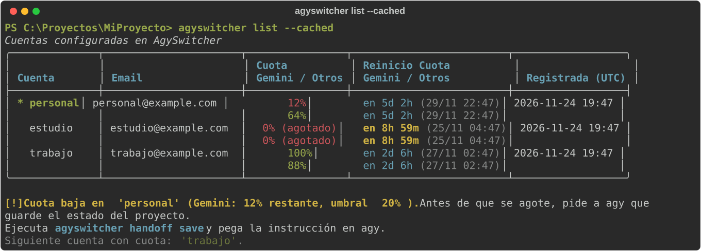
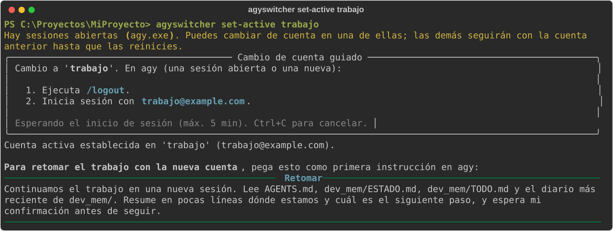
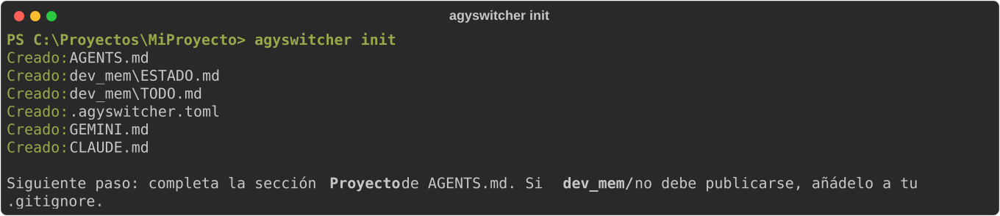
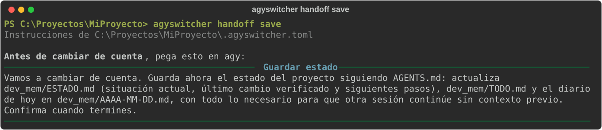
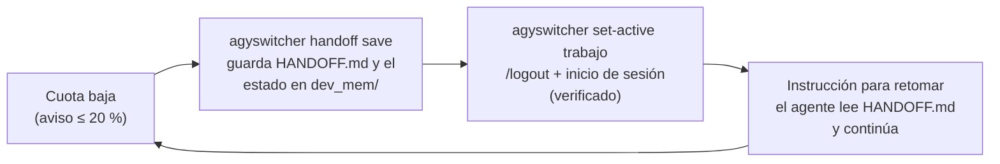

{ width="480" }
{ width="480" }

*Switch accounts. Keep coding.*

**Trabaja con varias cuentas de Google en Antigravity CLI (`agy`) y sigue con el mismo
proyecto cuando una cuenta se queda sin cuota.**

[Descargar para Windows](https://github.com/gabimarti/agyswitcher/releases){ .md-button .md-button--primary }
[Leer el manual](manual/index.md){ .md-button }

---

## ¿Para quién es?

Para quien quiere **programar con un agente de IA sin pagar una suscripción**, o probarlo a
fondo antes de decidirse: estudiantes, personas que empiezan a programar y programadores
independientes. Antigravity CLI se puede usar gratis con una cuenta de Google, pero su cuota
gratuita es limitada y se reinicia cada semana. Con varias cuentas propias puedes seguir
trabajando… y AgySwitcher hace que cambiar de una a otra no te cueste el hilo del proyecto.

[Así se usa en el día a día](manual/dia-a-dia.md){ .md-button }

## El problema

Cuando la cuota semanal de tu cuenta se agota en mitad de una tarea, cambiar a otra cuenta
es fácil; lo difícil es **no perder el hilo**: qué estabas haciendo, qué quedaba pendiente y
qué decisiones habías tomado. Y con varias cuentas, saber cuál tiene cuota y cuándo se
reinicia cada una se vuelve un trabajo en sí mismo.

## Qué hace AgySwitcher

<div class="grid cards" markdown>

- **Cuota de todas tus cuentas**

    Porcentaje restante de cada pool (Gemini / Otros), fecha de reinicio y cuál es la
    siguiente cuenta disponible, en una sola tabla.

- **Aviso a tiempo**

    Cuando la cuota baja del 20 % (configurable), te avisa para que el agente guarde el
    estado del proyecto y prepare el fichero de traspaso `HANDOFF.md` **antes** de quedarse sin
    tokens.

- **Cambio de cuenta guiado y verificado**

    Te dice con qué email iniciar sesión en `agy` y comprueba que lo has hecho, para no
    mezclar las cuotas de una cuenta con las de otra.

- **El proyecto recuerda dónde estabas**

    `agyswitcher init` prepara tu proyecto con `AGENTS.md` y una memoria en `dev_mem/`
    que la siguiente sesión, con otra cuenta o con otro agente, lee para continuar.

- **Multiagente y multiproveedor**

    Combina `agy` con Claude Code, Codex de ChatGPT, GitHub Copilot o Cursor: todos leen las
    mismas reglas desde `AGENTS.md` y la misma memoria en `dev_mem/`.
    [Cómo funciona](manual/multiagente.md).

- **Seguro por diseño**

    No lee ni guarda contraseñas ni tokens, nunca inicia sesión por ti, no modifica la
    carpeta de `agy` y no envía nada fuera de tu equipo.

</div>

## Así se ve

=== "Cuentas y cuota"

    

=== "Cambio de cuenta guiado"

    

=== "Preparar un proyecto"

    

=== "Guardar el estado"

    

*Pantallazos generados con cuentas ficticias.*

## Cómo funciona

`agy` guarda **una única sesión de Google** y su carpeta de trabajo (historial,
conversaciones, MCP, *skills*) es común a todas las cuentas. AgySwitcher se apoya en eso:



Más detalle en [Conceptos](manual/conceptos.md).

## Empieza en cinco minutos

```powershell
agyswitcher add personal --email personal@example.com
agyswitcher add trabajo  --email trabajo@example.com --no-activate
cd C:\Proyectos\MiProyecto
agyswitcher init
agyswitcher list
```

Sigue el [tutorial de proyecto nuevo](tutoriales/proyecto-nuevo.md) o el de
[proyecto existente](tutoriales/proyecto-existente.md).

## Requisitos

Windows 10 u 11 y Antigravity CLI (`agy`). Con el [instalador](manual/instalacion.md) no
necesitas Python ni permisos de administrador.

## Para saber más

En el artículo [Programar con agentes de IA a coste cero: cuotas, contexto y continuidad](https://gabimarti.medium.com/programar-con-agentes-de-ia-a-coste-cero-cuotas-contexto-y-continuidad-624b245177de)
(Medium) cuento por qué nació AgySwitcher y cómo organizo un proyecto para poder cambiar de
cuenta o de agente sin perder el contexto.

## Apoya el proyecto

AgySwitcher es y seguirá siendo **gratuito y de código abierto**. Si te resulta útil y quieres
apoyarlo, puedes invitarme a un café. Es totalmente voluntario y no da acceso a nada extra:
solo ayuda a dedicarle más horas.

[{ .kofi-cup }Invítame a un café en Ko-fi](https://ko-fi.com/gabimarti){ .kofi-button }

---

AgySwitcher es software libre bajo licencia
[GPL-3.0-or-later](https://github.com/gabimarti/agyswitcher/blob/main/LICENSE). Código fuente,
incidencias y contribuciones en
[GitHub](https://github.com/gabimarti/agyswitcher).
