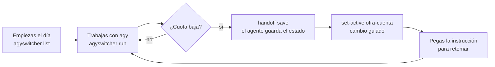
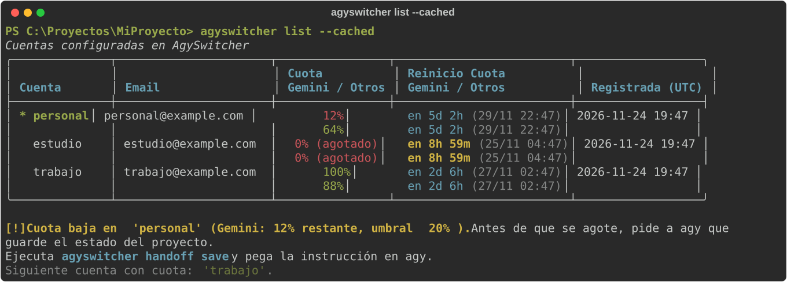
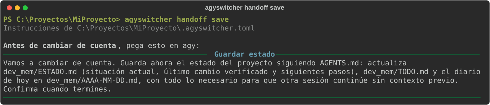
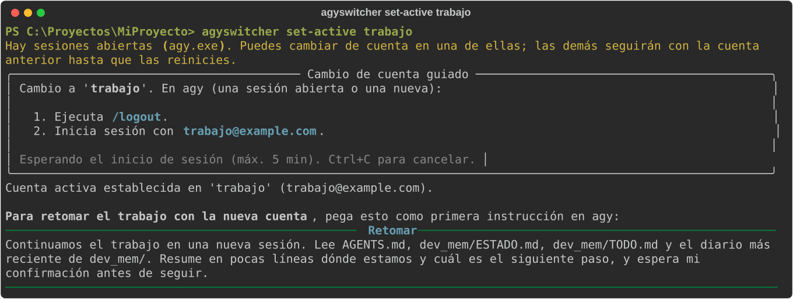

# AgySwitcher en el día a día

Esta guía explica, con ejemplos, cómo encaja AgySwitcher en tu forma de trabajar: qué haces
al empezar, mientras programas, cuando la cuota se acaba y al terminar. Si es la primera vez,
empieza por la [instalación](instalacion.md) y el [tutorial de proyecto nuevo](../tutoriales/proyecto-nuevo.md).

## ¿Para quién es?

AgySwitcher está pensado para quien **programa con un agente de IA sin pagar una
suscripción**, o quiere probarlo a fondo antes de decidirse:

- **Estudiantes** que hacen prácticas, TFG o proyectos personales.
- **Personas que empiezan a programar** y se apoyan en un agente para aprender.
- **Programadores independientes** y proyectos pequeños, donde cada gasto cuenta.

Antigravity CLI (`agy`) se puede usar gratis con una cuenta de Google, pero la cuota gratuita
es **limitada** y se reinicia cada semana. Es fácil agotarla a mitad de una tarea. Si tienes
varias cuentas de Google, puedes seguir trabajando con otra… y ahí aparecen los problemas que
resuelve AgySwitcher:

| Sin AgySwitcher | Con AgySwitcher |
| :--- | :--- |
| No sabes cuánta cuota le queda a cada cuenta ni cuándo se reinicia. | `agyswitcher list` te lo muestra en una tabla. |
| Te enteras de que se acabó cuando el agente deja de responder. | Te avisa al bajar del 20 % y guarda el fichero HANDOFF.md para no perder el contexto. |
| Cambias de cuenta y no sabes si `agy` usa la que crees. | El cambio es guiado y se verifica en los registros de `agy`. |
| La nueva sesión empieza de cero: hay que volver a explicarlo todo. | El proyecto guarda su memoria en `dev_mem/` y la nueva sesión la lee para continuar. |

!!! note "Uso responsable"
    Usa solo cuentas que sean tuyas y respeta las condiciones de servicio de Google.
    AgySwitcher no elude ningún límite: cada cuenta gasta su propia cuota. Tampoco inicia
    sesión por ti ni toca tus contraseñas o tokens; solo te guía y comprueba el resultado.

## La idea en una frase

**El contexto vive en el proyecto, no en la cuenta.** Por eso puedes cambiar de cuenta (o de
agente) sin perder el hilo: lo que importa está en `AGENTS.md` y `dev_mem/`, dentro de tu
carpeta.



## Preparación (una sola vez)

La preparación tiene tres pasos. Si los haces el primer día, después cambiarás de cuenta al
instante, sin navegador.

### 1. Registra tus cuentas

Antes, inicia sesión en `agy` con la primera cuenta. Después registra todas con su email:

```powershell
agyswitcher add uni      --email uni@example.com
agyswitcher add personal --email personal@example.com --no-activate
agyswitcher add extra    --email extra@example.com    --no-activate
```

Usa alias que reconozcas de un vistazo (`uni`, `personal`, `extra`…). La cuenta con la que
tienes la sesión iniciada en `agy` (`uni` en el ejemplo) queda ya preparada.

### 2. Prepara el slot de cada cuenta

Para cambiar a una cuenta sin navegador, AgySwitcher necesita haberla visto con la sesión
iniciada **una vez**. Así guarda su sesión en un *slot* del Administrador de credenciales de
Windows (ver [conceptos](conceptos.md)).
Hazlo ahora con cada cuenta que **no** muestre `[slot]` en `agyswitcher list`:

```powershell
agyswitcher list                 # las cuentas preparadas muestran [slot]
agyswitcher set-active personal  # cambio guiado: en agy, /logout y entra con personal@...
agyswitcher set-active extra     # lo mismo con extra@...
agyswitcher set-active uni       # vuelta a la primera: ya es instantáneo
agyswitcher list                 # ahora todas muestran [slot]
```

En cada cambio guiado, AgySwitcher te dice con qué email entrar. Comprueba que has iniciado
sesión con esa cuenta y guarda su slot. Solo pasas por el navegador **una vez por cuenta**:
`/logout` no invalida los slots que ya tienes guardados.

!!! tip "¿Has cambiado de cuenta directamente en `agy`?"
    Si haces `/logout` y `/login` dentro de `agy` sin pasar por `set-active`, ejecuta después
    `agyswitcher list` (o `status`, `sync` o `run`). AgySwitcher verá la sesión nueva y guardará
    el slot de esa cuenta.

Vuelve a preparar el slot de una cuenta (otro `set-active` guiado) solo si Google invalida
su sesión guardada. Lo notarás porque AgySwitcher te pide el navegador para esa cuenta.

### 3. Prepara cada proyecto

```powershell
cd C:\Proyectos\MiPractica
agyswitcher init
```

Después abre `AGENTS.md` y completa la sección **Proyecto** (o pídeselo al agente): cuanto
mejor descrito esté el proyecto, mejor retomará el trabajo cualquier sesión nueva.

Si algo no cuadra, `agyswitcher doctor` revisa la instalación y te dice cómo arreglarlo.

## Un día normal

### 1. Al empezar: ¿qué cuenta tiene cuota?

```powershell
agyswitcher list
```



La cuenta activa aparece primero; el resto, ordenadas por el reinicio más próximo. Cada
cuenta tiene **dos cuotas independientes** (pools): *Gemini* (modelos Gemini) y *Otros*
(modelos como Claude o GPT-OSS dentro de `agy`). Si una se agota, la otra puede seguir
disponible en la misma cuenta.

### 2. Mientras trabajas: lanza `agy` a través de AgySwitcher (flujo principal)

```powershell
cd C:\Proyectos\MiPractica
agyswitcher run
```

Es la forma habitual y recomendada: ejecuta `agy` con tu modelo preferido inyectado, comprueba que la cuota esté fresca al arrancar (avisando si baja del 20 %) y, si la cuota se agota durante la sesión, te indica cómo continuar al salir.

Si prefieres abrir `agy` directamente por tu cuenta (por ejemplo, desde la terminal integrada de VS Code o Cursor), abre una segunda ventana y deja en segundo plano el modo observador avanzado:

```powershell
agyswitcher watch
```

En la primera instrucción de cada sesión, pide al agente que se ponga al día:

> Lee AGENTS.md y dev_mem/ESTADO.md y dime en qué punto estamos.

(`agyswitcher handoff resume` te da esta instrucción completa, lista para pegar.)

### 3. Aviso de cuota baja: guarda el estado **antes** de que se acabe

Cuando la cuota del pool que usas baja del 20 %, AgySwitcher te avisa. Ejecuta
`agyswitcher handoff save` para guardar `dev_mem/HANDOFF.md` y pega la instrucción en `agy`:



El agente actualiza `dev_mem/ESTADO.md` (qué se ha hecho, qué falta, decisiones tomadas),
`dev_mem/TODO.md` y el diario del día. Hazlo ahora: si esperas a que la cuota llegue a cero,
el agente ya no podrá escribir nada.

!!! tip
    Antes de cambiar de cuenta, haz también un `git commit`. Así el estado del código y el de
    la memoria del proyecto coinciden.

### 4. Cambia de cuenta (conmutación instantánea o guiada)

```powershell
agyswitcher set-active personal
```

Si la cuenta destino ya dispone de slot guardado en Windows Credential Manager (mostrado con
`[slot]` en `agyswitcher list`), el cambio se realiza **al instante**: AgySwitcher promueve su
sesión a la activa de `agy` sin necesidad de abrir el navegador ni ejecutar `/logout`.
**Sal antes de `agy` con `/exit`** (y cierra el IDE de Antigravity si lo usas): si queda una
sesión abierta, AgySwitcher te avisa y te pregunta antes de cambiar.

Si la cuenta no tiene slot guardado aún (o si la sesión expiró), AgySwitcher inicia el
**cambio guiado**:



AgySwitcher te muestra con qué email entrar. En `agy` escribe `/logout` e inicia sesión en el
navegador con esa cuenta. AgySwitcher lo comprueba en los registros de `agy`, guarda su slot en
Credential Manager para futuros cambios instantáneos, consulta la cuota y te ofrece la
instrucción para retomar.

¿No sabes cuál elegir? `agyswitcher rotate` elige por ti: si el pool que usas está agotado
y el otro de la misma cuenta está libre, cambia de pool (sin tocar la sesión); si no, te lleva
a la siguiente cuenta con cuota (de forma instantánea si tiene slot o guiada si no).

### 5. Retoma donde lo dejaste

Abre `agy` de nuevo (las ventanas abiertas siguen con la cuenta anterior) y pega la
instrucción para retomar. El agente lee la memoria, te resume en qué punto estáis y espera tu
confirmación antes de seguir.

### 6. Al terminar el día

Aunque te quede cuota, guarda el estado:

```powershell
agyswitcher handoff save
```

Mañana, con la misma cuenta o con otra, la sesión nueva sabrá exactamente dónde seguir.

## Tres casos prácticos

### Ana, estudiante: una práctica en una semana

Ana tiene tres cuentas de Google (`uni`, `personal` y `extra`) y una práctica de programación
con entrega el viernes.

```powershell
cd C:\Uni\Practica3
agyswitcher init                 # una vez
agyswitcher list                 # 'uni' tiene un 60 %
agyswitcher run                  # trabaja toda la tarde
# aviso: 'uni' al 12 % -> pega la instrucción de guardado en agy
git commit -am "Parte 1 terminada"
agyswitcher set-active personal  # /logout + inicio de sesión con personal
agyswitcher run                  # pega la instrucción para retomar y sigue
```

El miércoles, `agyswitcher list` le muestra que `uni` se reinicia el sábado y que `extra`
está sin usar: ya sabe con qué cuenta acabará la práctica.

### Marcos, programador independiente: un encargo pequeño

Marcos hace una web para un cliente. Trabaja con `agy` y, cuando el pool *Gemini* se agota,
`agyswitcher rotate` pasa al pool *Otros* de la misma cuenta, sin cerrar sesión. Solo cuando
también se acaba cambia de cuenta. Como todo el contexto está en `dev_mem/`, puede dejar el
proyecto una semana y retomarlo en minutos.

### Laura, que combina agentes

Laura usa `agy` gratis para el trabajo diario y, de vez en cuando, Claude Code o Codex para
una revisión a fondo. Todos leen el mismo `AGENTS.md` y la misma memoria en `dev_mem/`.
Lo explica la página [Varios agentes y proveedores](multiagente.md).

## Buenas prácticas

- **Registra siempre el email** de cada cuenta: sin él no se puede verificar el cambio.
- **Prepara el slot de todas las cuentas el primer día** (todas con `[slot]` en `list`): así
  ningún cambio de cuenta te obliga a abrir el navegador cuando se acaba la cuota.
- **Guarda el estado pronto**: al aviso de cuota baja, al final del día y antes de cualquier
  cambio de cuenta o de agente.
- **Pide al agente que mantenga la memoria al día**: «cuando termines esta tarea, actualiza
  dev_mem/ESTADO.md».
- **Haz commits pequeños y frecuentes**: el historial de Git es otra forma de memoria.
- **Revisa `agyswitcher list` al empezar la semana**: verás qué cuentas ya se reiniciaron.
- **No guardes secretos en `dev_mem/`** (contraseñas, tokens, datos personales).
- **Si algo no cuadra**, ejecuta `agyswitcher doctor`.

## Chuleta

| Quiero… | Comando |
| :--- | :--- |
| Ver la cuota de mis cuentas | `agyswitcher list` |
| Trabajar con aviso de cuota | `agyswitcher run` |
| Vigilar `agy` abierto desde otro sitio | `agyswitcher watch` |
| Guardar el estado del proyecto | `agyswitcher handoff save` |
| Cambiar a una cuenta concreta | `agyswitcher set-active <alias>` |
| Que AgySwitcher elija la siguiente | `agyswitcher rotate` |
| Retomar después del cambio | `agyswitcher handoff resume` |
| Preparar un proyecto | `agyswitcher init` |
| Comprobar que todo está bien | `agyswitcher doctor` |
| Ver qué cuentas tienen slot | `agyswitcher list` (`[slot]`) |

Todas las opciones están en la [referencia de comandos](comandos.md).
