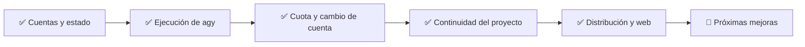

# Hoja de ruta

**AgySwitcher** es una herramienta para Windows 10/11 que ayuda a trabajar con varias
cuentas de Google en Antigravity CLI (`agy`): sigue la cuota de cada cuenta, avisa antes de
que se agote, guía y verifica el cambio de cuenta, y mantiene la memoria del proyecto para
que la siguiente sesión, con otra cuenta o con otro agente, continúe donde se dejó. Nunca
lee ni guarda contraseñas ni tokens.

Esta página resume qué hace ya, las versiones publicadas y lo que está previsto. El detalle
de cada versión está en el [registro de cambios](https://github.com/gabimarti/agyswitcher/blob/main/CHANGELOG.md).

---

## Qué hace ya

### Cuentas y estado local ✅

- Registro de cuentas con alias y email (`add`, `remove`, `list`, `status`), validados al
  crearlos y al leer la configuración.
- Configuración y estado en `%USERPROFILE%\.agyswitcher` (`config.json`, `state.json`), con
  escritura atómica. La carpeta se puede cambiar con `AGYSWITCHER_HOME`.
- Detección de la cuenta con sesión iniciada en `agy` leyendo sus registros, sin tocar
  credenciales; `sync` alinea la cuenta activa con la sesión real.

### Ejecución de `agy` ✅

- `run` lanza `agy` sin intérprete de comandos intermedio, muestra su salida en tiempo real y
  la sanea (tokens, cookies y cabeceras de autorización) antes de cualquier registro.
- Mientras `agy` está abierto, `run` vigila también sus registros, así que detecta la cuota
  agotada aunque `agy` se use en modo interactivo.
- `Ctrl+C` y cierre limpio de todo el árbol de procesos en Windows.
- Las consultas a `agy` (cuota, modelos, versión) tienen un tiempo máximo garantizado y nunca
  esperan entrada del teclado.

### Cuota y cambio de cuenta ✅

- Dos cuotas semanales independientes por cuenta (pools *Gemini* y *Otros*), con porcentaje
  restante y fecha de reinicio (`list`, `usage`, `dashboard`).
- Detección de cuota agotada en la salida de `agy` (`run`) y en sus registros (`watch`).
- **Cambio de cuenta guiado y verificado** (`set-active`, `rotate`): AgySwitcher indica con
  qué email iniciar sesión y lo comprueba en los registros de `agy`. Si el pool en uso se
  agota y el otro está libre, cambia de pool sin iniciar sesión.
- Propuesta de la siguiente cuenta con cuota; si todas figuran agotadas según los datos
  guardados, sugiere cuál comprobar primero (la cuota a veces se restablece antes de tiempo).
- Aviso de cuota baja con umbral configurable (`config`, o por proyecto en
  `.agyswitcher.toml`).
- Modelo preferido por pool y cuenta (`models`), que `run` usa automáticamente.
- `%USERPROFILE%\.gemini` es común a todas las cuentas y AgySwitcher no la modifica: se
  conservan historial, conversaciones, MCP y *skills* al cambiar de cuenta.

### Continuidad del proyecto ✅

- `init` prepara el proyecto: `AGENTS.md` como documento único de reglas, ficheros para
  Gemini/agy, Claude Code, Copilot y Cursor que remiten a él, y memoria en `dev_mem/`. Nunca
  sobrescribe; `--merge` completa lo que falte.
- `handoff save` y `handoff resume`: instrucciones para guardar el estado y retomarlo, válidas
  para cualquier agente y personalizables por proyecto. `handoff save` persiste el traspaso en
  `dev_mem/HANDOFF.md` (o `HANDOFF.md`) con soporte de notas (`--note`).
- La copia automática al portapapeles se desactiva por defecto para que el login en el navegador
  no pise el contexto; la información queda preservada en `HANDOFF.md` (y se puede copiar con `-c`).

### Diagnóstico y experiencia en la terminal ✅

- `doctor`: revisa `agy`, cuentas, estado, sesión, antigüedad de la cuota, procesos abiertos y
  el proyecto actual, y explica cómo arreglar cada problema. Enmascara los emails para poder
  compartir la salida.
- `dashboard`: panel en la terminal con cuentas, cuotas e historial de cambios.
- Ayuda de cada comando con ejemplos.

### Distribución, web y seguridad ✅

- Instalador para Windows por usuario (sin administrador ni Python) y ZIP portable, con
  SHA-256 publicados.
- Compilación automática en GitHub Actions al publicar una versión, con dependencias de versión
  exacta verificadas por hash e Inno Setup verificado por SHA-256.
- Web con manual, tutoriales y guías ([Uso en el día a día](manual/dia-a-dia.md),
  [Varios agentes y proveedores](manual/multiagente.md)), construida con Zensical.
- Revisión de seguridad del código y de la integración continua (acciones fijadas por SHA y
  Dependabot).
- Licencia GPL-3.0-or-later.

---

## Versiones publicadas

| Versión | Fecha | Lo principal |
| :--- | :--- | :--- |
| **1.3.0** | 2026-11-20 | Comando `doctor`, guías «Uso en el día a día» y «Varios agentes y proveedores», web con Zensical. |
| **1.2.0** | 2026-11-19 | Umbral de cuota baja configurable y portapapeles, cuota restablecida antes de tiempo, logotipo, revisión de seguridad y compilación reproducible. |
| **1.1.0** | 2026-11-19 | `run` propone cómo continuar al agotarse la cuota; consultas a `agy` con tiempo máximo (`add` ya no bloquea la consola). |
| **1.0.0** | 2026-11-18 | Primera versión pública: instalador, ZIP portable, manual y web. |

---

## Próximas mejoras 🔄

- [ ] Al agotarse la cuota, retomar la misma conversación de `agy` con la siguiente cuenta, sin
  salir de `run` ni copiar instrucciones.
- [ ] Salida `--json` en `list`, `status` y `usage`, con códigos de salida documentados, para
  usar AgySwitcher desde scripts.
- [ ] Autocompletado de comandos y alias de cuentas en PowerShell.
- [ ] Cuentas preferidas o excluidas por proyecto (por ejemplo, no usar la cuenta personal en
  un proyecto de cliente).
- [ ] Publicación en `winget`.
- [ ] Notificación de Windows cuando la cuota baja o se agota.
- [ ] Firma de código del ejecutable y del instalador.
- [ ] Validación en una máquina limpia de Windows 10/11 sin entorno de desarrollo.

¿Tienes una idea o has encontrado un error? Abre una
[incidencia en GitHub](https://github.com/gabimarti/agyswitcher/issues).
