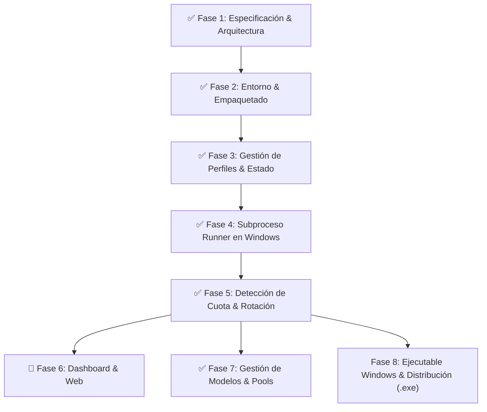

# Roadmap — AgySwitcher

Este documento describe el plan de evolución y entrega de **AgySwitcher**, una herramienta nativa para Windows (10/11) que orquesta y gestiona múltiples cuentas y cuotas para Antigravity CLI (`agy`).

AgySwitcher está diseñado desde sus cimientos para resolver los desafíos específicos de Windows (manejo de paths, ejecutables `.cmd`/PowerShell, bloqueo de archivos en disco y permisos de symlinks/junctions), priorizando la seguridad y respetando la integridad de las credenciales de Google.

---

## Fases de Desarrollo

---

### ✅ Fase 1: Especificación y Arquitectura (`agyswitcher/docs/architecture.md`)
- [x] Definir el mecanismo seguro de conmutación de perfiles en Windows → **NTFS Directory Junction** (sin permisos de admin).
- [x] Documentar la interacción con el proceso `agy` en Windows → `agy.exe` nativo, sin `.cmd`. `shutil.which("agy")` lo resuelve. Ruta de config fija en `%USERPROFILE%\.gemini\`.
- [x] Definir el esquema de metadatos y estado local en `%USERPROFILE%\.agyswitcher\config.json` y `state.json`.

---

### ✅ Fase 2: Infraestructura del Proyecto y Empaquetado
- [x] Crear y configurar `agyswitcher/pyproject.toml` (typer, rich, pytest, ruff, mypy).
- [x] Configurar el entry point del comando CLI (`agyswitcher`).
- [x] Configurar entorno virtual (`.venv`) e instalación editable con `pip install -e ".[dev]"`.
- [x] Crear estructura inicial del paquete con stubs de todos los comandos CLI.
- [x] `pytest` (10/10), `ruff check`, `ruff format --check` y `mypy src` pasan sin errores.
- [x] Scripts de automatización para crear el entorno y ejecutar todos los checks de calidad.

---

### ✅ Fase 3: Gestión de Perfiles y Estado Local

#### 3a — Capa de datos ✅
- [x] `agyswitcher/models.py`: dataclasses `Account` y `AppState`.
- [x] `agyswitcher/config.py`: lectura/escritura de `~/.agyswitcher/config.json`.
- [x] `agyswitcher/state.py`: lectura/escritura de `~/.agyswitcher/state.json`.
- [x] Tests unitarios de I/O (lectura, escritura, fichero ausente, JSON corrupto).

#### 3b — Comandos de escritura ✅
- [x] Lógica real de `agyswitcher add <alias>`: registra cuenta en `config.json`, valida duplicados y formato.
- [x] Lógica real de `agyswitcher list`: lista cuentas con estado (activa / disponible / parcial / agotada).
- [x] Tests de integración de ambos comandos con aislamiento de rutas de configuración.

#### 3c — Comando de consulta y cierre de fase ✅
- [x] Lógica real de `agyswitcher status`: detalle de cuenta activa y pools de cuota.
- [x] Pulido de output con `rich` (tablas, colores y compatibilidad ASCII para consolas Windows).
- [x] Documentación actualizada (`architecture.md`, `README.md`).
- [x] Todos los checks en verde al cierre.

---

### ✅ Fase 4: Subproceso Runner Nativo para Windows (`run`)

#### 4a — Localizador y Sanitizador de salida ✅
- [x] Localizador y resolución de `agy.exe` en `PATH` de Windows (`find_agy_executable`) con excepción `AgyNotFoundError`.
- [x] Sanitizador en memoria (`sanitize_line`) para redacción estricta de tokens, cookies y cabeceras de autorización.
- [x] Tests unitarios de resolución y sanitización en `tests/test_runner.py`.

#### 4b — Motor de Subproceso y Señales en Windows ✅
- [x] Invocación segura de subprocesos (`Popen`, `shell=False`, `CREATE_NEW_PROCESS_GROUP`).
- [x] Streaming de salida en tiempo real a la consola del usuario y callback para observadores.
- [x] Manejo de `KeyboardInterrupt` (`Ctrl+C`), propagación de señales y terminación limpia con `taskkill` (`kill_process_tree`).
- [x] Tests unitarios con emulación y mocks de procesos en `tests/test_runner.py`.

#### 4c — Integración en CLI y Cierre de Fase ✅
- [x] Integración del comando `run` en `cli.py` con comprobación de cuenta activa previa y propagación de código de salida.
- [x] Tests de integración del CLI para `run` en `test_cli.py`.
- [x] Todos los checks de calidad en verde (pytest, ruff, mypy).

---

### ✅ Fase 5: Detección de Cuota y Rotación (`rotate`, `watch`)

#### 5a — Refactorización del modelo de estado a dos pools ✅
- [x] Adaptación del modelo `AppState` a dos pools semanales independientes por cuenta (`gemini` y `external`).
- [x] Comandos `list` y `status` actualizados para reflejar disponibilidad y agotamiento por pool.
- [x] Tests unitarios y de integración actualizados.

#### 5b — Parser de errores de cuota ✅
- [x] Implementar parser de errores y patrones de agotamiento de cuota por pool en `quota.py` (`gemini` vs `external`).
- [x] Integración con el callback en tiempo real del runner en `cli.py` (`run`) con persistencia inmediata al interceptar cuota agotada.
- [x] Suite de tests unitarios e integración completa (`tests/test_quota.py`, `tests/test_cli.py`).

#### 5c — Rotación automática y observador ✅
- [x] Implementar política de rotación de pool y de cuenta (`rotate`) con selección en cascada.
- [x] Soporte para conmutación de perfiles mediante NTFS Directory Junctions (`mklink /J`).
- [x] Implementar modo observador (`watch`) para supervisión en streaming de registros y rotación inmediata.
- [x] Suite completa verificada con 79 tests.

#### 5d — Gestión Física de Perfiles y Conmutación Real de Sesión en Windows ✅
- [x] Almacenamiento aislado de perfiles en disco (`%USERPROFILE%\.agyswitcher\profiles\<alias>`) y sembrado inicial de preferencias/skills (`seed_profile_from_base`).
- [x] Conmutación física atómica de `%USERPROFILE%\.gemini` como Junction NTFS (`mklink /J`) para cambio instantáneo de cuenta en `agy` (`swap_junction`, `migrate_live_to_profile`).
- [x] Auto-detección reactiva de sesión y advertencia de reconciliación en `list` y `status` si se detecta discrepancia externa en `agy` con sugerencia de sincronización (`check_session_mismatch`, `print_session_mismatch_warning`).
- [x] Refresco inmediato de cuota tras registrar una nueva cuenta activa (`add` ejecuta `fetch_usage` y persiste `AccountQuotaInfo` en `state.json`).

#### 5e — Robustez de la conmutación de perfiles ✅
- [x] **A.** Timeout y `stdin` desconectado en todos los comandos de sistema de gestión de junctions (`mklink` / `rmdir`) mediante un único helper (`_run_link_command`).
- [x] **B.** Conmutación de `%USERPROFILE%\.gemini` sin ventana en la que el directorio desaparezca (junction temporal, renombrado y rollback), validada con junctions reales y ficheros abiertos.
- [x] **C.** `list --refresh-all` restaura siempre la cuenta original, incluso ante errores o `Ctrl+C`; informa de las cuentas no actualizadas y no consulta la cuota si el perfil no pudo conmutarse (también en `set-active`). Capturas genéricas de `cli.py` sustituidas por errores específicos.
- [x] **Tests aislados del entorno real:** `Path.home()`, `USERPROFILE` y `HOME` redirigidos a un directorio temporal en toda la suite.
- [x] **D.** Sustitución de capturas genéricas de excepciones por excepciones específicas en el runner: limpieza del proceso hijo garantizada en `finally`, solo los errores de E/S se convierten en `RunnerError`.
- Suite ampliada a **172 tests**.

#### 5f — Conmutación efectiva de sesión *(siguiente)*
- [x] **1.** `rotate`, `watch`, `set-active`, `sync` y `add --activate` informan de forma visible (en rojo, código 1) si el cambio físico de perfil no se ha podido aplicar, sin modificar la cuenta activa en `state.json`. La rotación se niega a migrar un `%USERPROFILE%\.gemini` que aún es una carpeta normal, para no copiar la sesión de una cuenta al perfil de otra. Suite ampliada a **180 tests**.
- [x] **2a.** Hallazgo: `agy` guarda la sesión de Google en el Administrador de credenciales de Windows, no en `%USERPROFILE%\.gemini`; la junction no cambia la cuenta. Nuevo módulo `session.py` para verificar un inicio de sesión solo con lo escrito en los logs después de una marca (`snapshot_log_offsets`, `detect_new_login_email`). Suite ampliada a **188 tests**.
- [x] **2b.** `rotate` / `set-active` como cambio guiado: comprueban que `agy` y el IDE están cerrados, cambian el perfil, piden `/logout` e inicio de sesión con la cuenta destino y esperan a verificarlo en los logs (`wait_for_login`, `--timeout`). Si no se verifica o se cancela, vuelven al perfil anterior sin tocar el estado. Suite ampliada a **217 tests**.
- [x] **2c (parcial).** `watch` propone la siguiente cuenta en lugar de rotar solo (el cambio de pool en la misma cuenta sigue siendo automático); `list` guarda la cuota en la cuenta con sesión iniciada y `--refresh-all` equivale a `--live`; `add` solo consulta la cuota (y solo se activa) si la sesión es de esa cuenta. Pendiente: aviso equivalente en `run`.
- [x] **2d.** Comando `migrate`: migración inicial guiada de `%USERPROFILE%\.gemini` a junction. Comprueba que `agy` y el IDE de Antigravity están cerrados, elige el perfil de la cuenta con sesión iniciada, mueve el contenido sin copiarlo, aparta (sin borrar) el contenido previo del perfil y deshace todo si algo falla. Ningún otro comando migra ya de forma implícita. `sync` se mantiene como reconciliación con la sesión real. Suite ampliada a **204 tests**.
- [x] **2b+.** Siembra de preferencias: al enlazar un perfil se completan, sin sobrescribir, `skills`, `antigravity-cli/settings.json`, `antigravity-cli/cache/onboarding.json` y `config/config.json`, para que `agy` no repita la configuración inicial (tema de color) en cada cuenta. No se copian `mcp_config.json`, historial ni conversaciones. Suite ampliada a **219 tests**.
- [x] Reinicio de `agy` tras una rotación: resuelto por el cambio guiado (2b), basado en un inicio de sesión nuevo.
- [x] **2e. Carpeta `.gemini` única (cambio de rumbo).** Los perfiles por cuenta no cambiaban la cuenta de Google y separaban historial, conversaciones, MCP y *skills*, que es lo que interesa conservar para seguir el mismo proyecto con otra cuenta. Se eliminan las junctions, `migrate` y la siembra de perfiles: `%USERPROFILE%\.gemini` es común y AgySwitcher no la modifica. El cambio guiado ya no exige cerrar `agy` ni cambia carpetas; solo indica el email, espera y verifica. Suite: **176 tests**.
- [x] **2f. Continuidad del proyecto entre cuentas y agentes.** `agyswitcher init` prepara un repositorio (`AGENTS.md` común, ficheros de Gemini/agy, Claude, Copilot y Cursor que remiten a él, `dev_mem/ESTADO.md`, `dev_mem/TODO.md`, `.agyswitcher.toml`) sin sobrescribir nada; `agyswitcher handoff [save|resume]` muestra las instrucciones de traspaso (personalizables por proyecto); aviso de cuota baja (≤ 15 %) en `list`, `status` y `run`; instrucción para retomar tras un cambio de cuenta verificado. Suite: **194 tests**.
- [x] **3.** Consultas no interactivas a `agy` (`agy -p /usage`, `agy models`) con tiempo máximo garantizado: entrada estándar vacía y, si se agota el tiempo, se termina todo el árbol de procesos. Corrige que `add` pudiera dejar la consola bloqueada cuando `agy` dejaba procesos hijos con la salida abierta. Suite: **221 tests**.

---

### 🔄 Fase 6: Experiencia de Usuario en Terminal, Web y Lanzamiento (EN PROGRESO)

#### 6a — Dashboard TUI en Terminal (`dashboard`) ✅
- [x] Módulo `dashboard.py`: componentes Rich (`build_system_summary_panel`, `build_accounts_table`, `build_history_panel`, `build_dashboard_view`).
- [x] Comando `agyswitcher dashboard`: matriz de cuentas, estado de pools con barras visuales ASCII, historial de rotaciones y soporte continuo interactivo (`--watch` / `--interval`).
- [x] Soporte para métricas en vivo integradas (`--live`).
- [x] Suite de tests unitarios e integración (102 tests pasando).

#### 6b — Pulido de UX, Gestión de Identidad y Ayuda CLI ✅
- [x] Ayuda enriquecida en `--help` con ejemplos claros de cada comando (`add`, `list`, `status`, `dashboard`, `usage`, `rotate`, `watch`, `run`).
- [x] Documentación pública completa en `agyswitcher/README.md` (incluyendo guía del comando `dashboard` con modos `--live` y `--watch`).
- [x] **Detección segura de identidad**: Extractor de solo-lectura `detect_active_email` para descubrir el email de Google autenticado en `agy` (`cli.log` / `log/*.log`) sin tocar credenciales ni tokens, con ordenación cronológica conjunta por fecha de modificación (`st_mtime`) y escaneo profundo (2000 líneas).
- [x] **Vínculo Email-Alias**: Campo `email` en modelo `Account` con soporte retrocompatible y visualización en `list`, `status` y `dashboard`.
- [x] **Comandos de gestión y corrección**: `remove` (conmutación inteligente si se borra la activa), `set-active` y `sync` (sincronización en vivo con `fetch_usage`, forzado de silent auth y actualización instantánea de cuotas en `state.json`).
- [x] **Protección contra contaminación en `usage`**: Advertencia de desajuste si la sesión real en `agy` no coincide con la cuenta activa configurada, evitando levantar cooldowns erróneos.
- [x] **Unificación estética de consola**: Sustitución de recuadros ASCII por `box.ROUNDED` en tablas y paneles para armonizar visualmente toda la salida CLI con la ayuda nativa de Typer.
- [x] **Métricas de Cuota y Tiempos de Reinicio en `list`**: Incorporación de columnas `% Gemini`, `% External` y `Reinicio Cuota` en `agyswitcher list` con soporte de `--live`, flag `--cached` para modo offline/instantáneo, auto-refresco inteligente por TTL (3 min) de la cuenta activa y modelo persistente `AccountQuotaInfo`.
- [x] **Rediseño de columnas de cuota en `list`**: Fusión de `% Gemini` y `% External` en columna única `Cuota` (doble fila: Gemini / Otros) y columna `Reinicio Cuota` también con doble fila (reset Gemini / reset Otros). Funciones auxiliares `_pct_str` y `_reset_str` extraídas fuera del bucle.
- [x] **Optimización de UX y ordenación en `list`**: Eliminación de columna redundante "Estado", visualización de cuenta activa en primera posición resaltada en verde brillante (`* <alias>`), ordenación ascendente del resto de cuentas por fecha de reinicio más próxima (identificación inmediata de la siguiente cuenta disponible) y flag `--refresh-all` (`-a`) para actualización en bloque de todas las cuentas. Auto-refresco de cuota en `set-active`.
- [x] Suite ampliada a **152 tests unitarios e integración pasando**.

#### 6c — Sitio web de usuario (GitHub Pages) ✅
- [x] Web con MkDocs Material sobre `docs/`: portada (problema, ventajas, pantallazos, cómo funciona, arranque rápido), manual, tutoriales y documentación técnica (`gabimarti.github.io/agyswitcher`).
- [x] Pantallazos generados con cuentas ficticias.
- [x] Construcción en modo estricto en la integración continua y publicación automática en GitHub Pages (al hacerse público el repositorio).

---

### ✅ Fase 7: Gestión de Modelos y Rotación por Pool
- [x] Inspección y comandos de cuota y sesión en vivo (`agyswitcher usage`, `status --live`).
- [x] Auto-recuperación de cooldowns cuando la cuota semanal se renueva (> 0%).
- [x] Inspección y comandos de modelos (`agyswitcher models`).
- [x] Selección y persistencia de modelo preferido por pool/cuenta (`models --set <id> [--account <alias>]`, `models --clear`).
- [x] Inyección automática de `--model <id>` en subproceso `agyswitcher run` según el pool activo, respetando elecciones manuales del usuario.
- [x] Suite completa de tests unitarios e integración ampliada a 127 tests pasando.

---

### Fase 8: Empaquetado Autónomo y Distribución en Windows (Desktop Standalone)
- [x] **Lanzamiento v1.0.0** *(2026-11-18)*: primera versión pública, con instalador, ZIP portable y SHA-256 en *Releases* y web en GitHub Pages.
- [x] **Manual y tutoriales** *(L2)*: `docs/manual/` (instalación, conceptos, comandos, continuidad, problemas frecuentes, desinstalación) y `docs/tutoriales/` (proyecto nuevo y existente); `init --merge`; README reducido; ayudas de comandos al día; `remove` ya no activa otra cuenta sin sesión. Suite: **209 tests**.
- [x] **Versión única y revisión** *(v0.9.0)*: `__version__` como fuente única (pyproject la lee con hatch), número de compilación en `_build.py` para los ejecutables (`MAJOR.MINOR.PATCH.BUILD`), `agyswitcher --version`, `CHANGELOG.md` y variable `AGYSWITCHER_HOME`. Suite: **202 tests**.
- [x] **Preparación del repositorio público** *(L4)*: licencia GPL-3.0-or-later con cabeceras SPDX, `CONTRIBUTING.md`, `SECURITY.md`, plantillas de issues, metadatos del paquete y auditoría de privacidad (sin datos reales, rutas personales ni secretos). Suite: **214 tests**.
- [x] **Ejecutable, instalador y compilación automática** *(L3)*: PyInstaller en modo carpeta con recurso de versión de Windows, ZIP portable, instalador Inno Setup por usuario (sin administrador, PATH del usuario, desinstalador), `SHA256SUMS.txt`, GitHub Actions (`ci.yml` y `release.yml` por etiqueta) y manual del instalador. Suite: **213 tests**.
- [x] **Generación de ejecutable nativo (`agyswitcher.exe`)** *(planificación original)*:
  - Compilación autocontenida de los scripts de Python mediante `PyInstaller` o `cx_Freeze`/`Nuitka` sin requerir que el usuario tenga Python instalado.
  - Empaquetado de recursos estáticos, plantillas y dependencias.
- [ ] **Distribución para usuario final sin fricción técnica**:
  - Creación de distribución portátil (ZIP con `.exe` listo para usar en cualquier carpeta o agregar al PATH).
  - Opcional: instalador ligero de escritorio de Windows (ej. vía Inno Setup o MSI) que configure automáticamente el acceso directo y la variable PATH del usuario.
- [ ] **Validación en entorno limpio**:
  - Verificación en máquina virtual o sandbox de Windows 10/11 sin entorno de desarrollo ni Python preinstalado.
